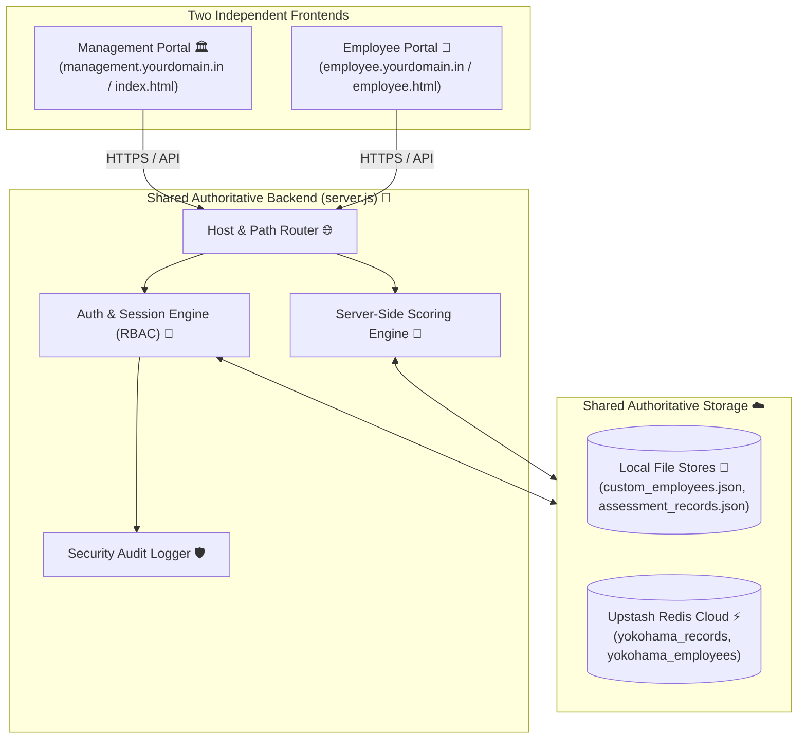

<div align="center">

  <h1>⚡ YOKOHAMA ILUO PORTAL | NO CAP CERTIFICATION SYSTEM 💅</h1>

  <p>
    <strong>The Most Aesthetic, Anti-Cheating, Auto-Excel Generating QA Exam Platform. Fr Fr. 🗣️🔥</strong><br>
    <em>Engineered for Yokohama Off-Highway Tires (OHT) Quality Assurance Legends.</em>
  </p>

  <p>
    <a href="https://nodejs.org"></a>
    <a href="https://expressjs.com"></a>
    <a href="https://upstash.com"></a>
    <a href="https://vercel.com"></a>
    <a href="https://developer.mozilla.org/en-US/docs/Web/JavaScript"></a>
  </p>

  <br />
</div>

---

## 🍵 Executive Summary

The **Yokohama ILUO Skill Assessment Portal** operates as **two independent websites** connected to a unified authoritative backend and shared database:

1. **Management Portal** (`index.html`): Executive control center for HR, Admin, Department/HODs, Section Supervisors, and Skill Evaluators.
2. **Employee Portal** (`employee.html` & `employee.js`): Independent, distraction-free portal exclusively for plant candidates taking assessments and tracking skill progression.

> [!IMPORTANT]
> - 🏢 **Management Portal (`management.yourdomain.in`)**: Role-scoped control center for company analytics, question bank manager, section tracking, practical skill evaluation, and audit Excel downloads.
> - 👤 **Employee Portal (`employee.yourdomain.in`)**: Dedicated employee app with individual profile, password toggle, 45-min timed MCQ assessment, tab-switch proctoring, and instant category scoring (Safety, Quality, Process, CI & TPM).
> - 🔒 **Strict Data Security & IDOR Isolation**: Authoritative server-side RBAC ensures employees cannot see other candidates' records or management tools.
> - 📊 **43 Automated Tests**: 100% test pass rate across GATE 1-14 security checks, auth suites, and multi-portal isolation tests.

---

## 🏗️ Architecture



---

## 🛠️ The Tech Stack

| Layer | Component | Description |
| :--- | :--- | :--- |
| **Management App** | `index.html` + `app.js` | Full enterprise control center, question bank manager, reports & charts |
| **Employee App** | `employee.html` + `employee.js` | Dedicated candidate experience, timer, MCQ exam runner & results |
| **Styling** | `styles.css` | Yokohama corporate theme with glassmorphism & responsive design |
| **Backend** | Express 5 / Node.js | Multi-site host router, RBAC session engine, PDF/DOCX compiler |
| **Database** | JSON file stores & Upstash Redis | Synchronized authoritative employee data and assessment scores |
| **Testing** | Node.js Test Runner (`node:test`) | 43 automated unit, integration, and security tests |

---

## 📂 File Directory

```ascii
yokohama-iluo-portal/
├── index.html                   # Website A: Management Portal Layout
├── app.js                       # Website A: Management Portal Controller
├── employee.html                # Website B: Dedicated Employee Portal Layout
├── employee.js                  # Website B: Dedicated Employee Portal Controller
├── server.js                    # Shared Express Backend, Host Router & RBAC
├── styles.css                   # Yokohama Corporate Design Tokens & Responsive Styles
├── vercel.json                  # Multi-Portal Vercel Deployment Configuration
├── DEPLOYMENT.md                # Complete Dual-Portal Vercel Deployment Guide
├── custom_employees.json        # Authoritative Directory of Plant Employees
├── custom_questions.json        # Synchronized Canonical Question Bank
├── master_questions.json        # Master Question Reference Dataset
├── assessment_records.json      # Live Exam Attempts and Scores
├── ojt_evaluations.json         # Shop-Floor Practical Skill Evaluations
├── audit_logs.json              # Security & Access Audit Log Trail
└── tests/                       # Automated Test Suites (43 passing tests)
    ├── auth.test.js             # Authentication tests for all roles
    ├── destructive.test.js      # Reset authorization checks
    ├── exam.test.js             # Exam lifecycle & anti-cheating tests
    ├── gate.test.js             # GATE 1 to GATE 14 security checks
    ├── security.test.js         # CSRF & sanitized payload tests
    └── two_portals.test.js      # 10 Dual-Portal isolation & routing tests
```

---

## ⚡ Quick Start (Get It Running in 30 Seconds)

### 1. Clone & Install
```bash
git clone https://github.com/ReubenGeoffrey/yokohama-iluo-portal.git
cd yokohama-iluo-portal
npm install
```

### 2. Configure Environment (`.env`)
```env
PORT=5000
SESSION_SECRET=yokohama_iluo_qa_secret_2026
ADMIN_EMAIL=admin@company.com

SMTP_HOST=smtp.gmail.com
SMTP_PORT=587
SMTP_USER=your_email@gmail.com
SMTP_PASS=your_app_password

UPSTASH_REDIS_REST_URL=https://your-redis-instance.upstash.io
UPSTASH_REDIS_REST_TOKEN=your_upstash_rest_token
```

### 3. Launch Server
```bash
npm start
```
Go to **`http://localhost:8080`** and enjoy the vibe! 🚀

---

## 📄 License & Ownership

Copyright © 2026 **Yokohama Off-Highway Tires (OHT)** / **Reuben Geoffrey**.  
*All Rights Reserved. Enterprise Grade Proprietary Code.*
